# Corso Velle



The Shopify theme behind [corsovelle.com](https://corsovelle.com). Liquid renders every page; TypeScript custom elements, GSAP and Vite add the motion on top. Catalog, cart, checkout, filters and SEO are Shopify's own. No separate storefront app, no React.

> Corso Velle's configured theme, not a packaged commercial release. No license is granted; see [LICENSE](LICENSE).

## Contents

- [Highlights](#highlights)
- [Quick start](#quick-start)
- [Branches and deploying](#branches-and-deploying)
- [Repository layout](#repository-layout)
- [Documentation](#documentation)
- [License](#license)

## Highlights

**Homepage**

| Section | What it does |
| --- | --- |
| Runway | Cut-out models walk a looping line-up; the centre look opens a shop-the-look panel with its products. Looks, names and products are editable. |
| On the rail | Garments hang edge-on and turn to face you; swipe or drag the rail, open one for front and model photos, sizes and price. |
| 9 TO 5 | Split section: portrait video beside the text, kept side by side on phones. |
| New arrivals | Any collection, optionally newest first. |

**Across the store**

| Area | What's included |
| --- | --- |
| Product page | Gallery with zoom, explicit size choice, size charts with cm/in, model info, sibling colourways, sticky add to cart |
| Size charts | Fourteen rules matched by product, collection, tag or words in the product name |
| Discovery | Collection tabs, category cards, predictive search, Search & Discovery filters and sorting |
| Cart | AJAX drawer and page, notes, recommendations, free-shipping progress, discount codes |
| Design | Colour schemes, three font roles, spacing, buttons, card styles, per-section options |
| Motion | GSAP entrances, Lenis smoothing on desktop, lighter phone motion, full reduced-motion support |

## Quick start

Requires Node.js 22.12+, 24 or 26+.

```sh
npm ci
npm run build
npm run watch                                      # terminal 1: rebuild assets on change
npm run dev -- --store your-store.myshopify.com    # terminal 2: Shopify preview
```

| Command | Does |
| --- | --- |
| `npm run check` | Typecheck, tests, build, JSON and schema checks, Theme Check. Run before committing. |
| `npm run package` | Builds the installable theme ZIP |
| `npm run shopify:pull` | Brings Theme Editor saves from `shopify` into `theme/` |
| `npm run shopify:deploy` | Publishes `main`'s `theme/` to the `shopify` branch |

Details and troubleshooting: [INSTALLATION.md](INSTALLATION.md).

## Branches and deploying

| Branch | Holds | Changed by |
| --- | --- | --- |
| `main` | Source, theme and docs. Work happens here. | You |
| `shopify` | Only `theme/`, at the top level. Connected to the store (Online Store → Themes → **Connect from GitHub**). | `shopify:deploy`, plus Shopify's own saves |
| `history` | Development history before the clean `main`. Reference only. | Nobody |

Code flows `main` → `shopify`; Theme Editor saves flow `shopify` → `main`. To publish:

```sh
git checkout main
npm run shopify:pull      # take in Theme Editor saves first
npm run check
git add <files> && git commit -m "Describe the change"
git push origin main
npm run shopify:deploy    # fast-forwards shopify with main's theme/
```

`shopify:deploy` refuses to run while `shopify` has saves `main` doesn't, so it can't wipe customizations. Never edit or force-push `shopify` by hand.

## Repository layout

```text
src/       TypeScript and CSS sources, built by Vite
theme/     The Shopify theme that gets uploaded (Liquid, JSON, built assets)
scripts/   Asset sync, watcher, checks, settings-reference generator
tests/     Vitest unit tests
docs/      Guides, settings reference, licenses
```

Edit `src/` and `theme/`. `theme/assets/nk-*` and `theme/snippets/nk-assets.liquid` are generated by the build; don't edit them by hand.

## Documentation

| Guide | Covers |
| --- | --- |
| [INSTALLATION.md](INSTALLATION.md) | Installing, developing from source, commands, packaging |
| [CUSTOMIZATION.md](CUSTOMIZATION.md) | Every Theme Editor area, what it controls and its limits |
| [DEVELOPMENT.md](DEVELOPMENT.md) | Architecture, sections and components, animation, commerce code |
| [Settings reference](docs/SETTINGS-REFERENCE.md) | Every setting, default and block, generated from the schemas |
| [Size chart settings](docs/SIZE-CHART-SETTINGS.md) · [Reusable charts](docs/SIZE-CHART-ADMIN.md) | Size charts from theme settings or shared metaobjects |
| [Promotions](docs/PROMOTIONS.md) | Connecting discount codes to products |
| [Model information](docs/MODEL-INFO.md) | Model height and size text on product pages |
| [Distribution](docs/DISTRIBUTION.md) | Preparing a release for another store |
| [Section sources](docs/SECTION-SOURCES.md) · [Third-party notices](THIRD_PARTY_NOTICES.md) | Where adapted parts came from, and their licenses |

## License

All rights reserved by the owner; no license is granted. Third-party parts keep their own licenses, listed in [THIRD_PARTY_NOTICES.md](THIRD_PARTY_NOTICES.md). The project started from [Shopify Skeleton](https://github.com/Shopify/skeleton-theme).

---

<sub>Designed and built by [OZ Studios](https://www.zaber.tech/oz-studio) · [Instagram](https://www.instagram.com/oz.studio._/)</sub>
