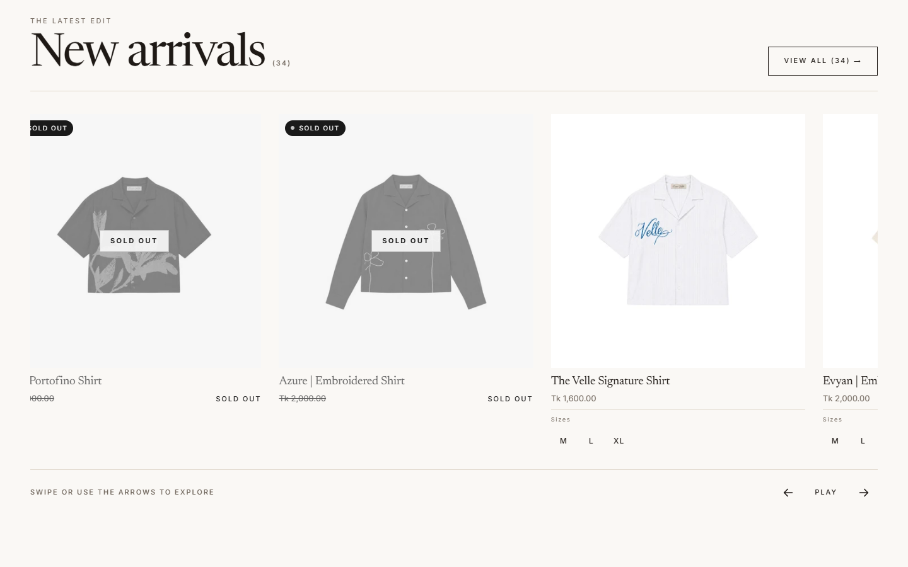
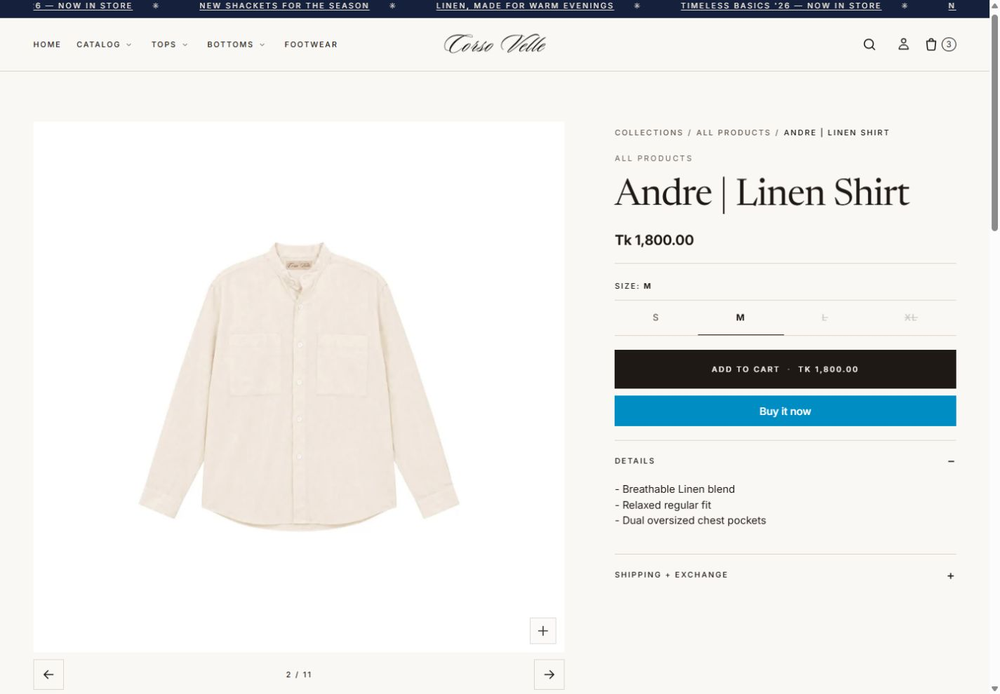
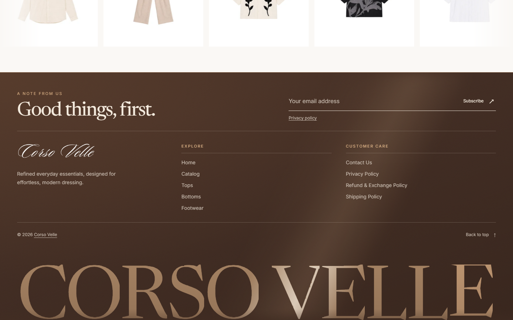

<h1 align="center">Corso Velle</h1>


<p align="center"><em>A custom storefront for timeless essentials.</em><br><sub>SHOPIFY ONLINE STORE 2.0 &nbsp; · &nbsp; VANILLA TYPESCRIPT &nbsp; · &nbsp; PURPOSEFUL MOTION</sub></p>

<p align="center">
  <a href="#the-experience">The experience</a> &nbsp; / &nbsp;
  <a href="#local-development">Get started</a> &nbsp; / &nbsp;
  <a href="#inside-the-project">Architecture</a> &nbsp; / &nbsp;
  <a href="#project-notes">Project notes</a>
</p>

A custom **Shopify Online Store 2.0 theme** for Corso Velle: editorial layouts, generous product photography, deliberate motion, and commerce powered by Shopify's real catalog and cart.

Built directly on Liquid, with vanilla TypeScript enhancing the interface. Shopify renders the storefront; Vite compiles its assets. No React, Hydrogen, or separate storefront backend.

| Editorial by design | Native at the core | Built with care |
| :--- | :--- | :--- |
| Uncropped photography, considered typography, and a continuous collection rail. | Liquid sections, Shopify product data, native filters, and the AJAX cart. | Typed modules, scoped GSAP motion, responsive controls, and lifecycle cleanup. |

> **Project status:** implemented storefront foundation with automated checks and recorded development-preview testing. Full release acceptance is still open; device, catalog, app, and checkout verification boundaries are documented in the audit reports below.

## The experience

<p><sub>01 / EXPLORE THE STOREFRONT</sub></p>



### A quieter way to explore

Image and video heroes, editorial storytelling, category layouts, and a continuous **New Arrivals carousel** give the homepage its rhythm. The collection rail supports touch scrolling, previous/next controls, autoplay pause, and reduced-motion preferences.

Collection pages use Shopify's native filtering and Section Rendering APIs, with sorting, active filters, pagination, and browser-history synchronization. Product cards share real variant links and purchase behavior across the theme.

### Product details that earn their space

- **Photography first.** A large gallery, thumbnails, media controls, and an image zoom dialog keep the product in focus.
- **An intentional size selector.** The animated underline and measurement panel remain, with explicit size selection and merchant-supplied measurements. Available charts support centimetres and inches.
- **Real variant state.** Prices, compare-at prices, availability, quantity rules, and purchase controls update from Shopify responses.
- **One clear purchase action.** The product page has a single Add to cart button. Cards offer direct size add when the choice is unambiguous; more complex products open an isolated quick-add dialog.
- **Honest product content.** Care, composition, sibling products, and sizing use configured Shopify data. Missing measurements are never filled with sample values.

<p align="center">
  
</p>

### Commerce that stays connected

| System | What it handles |
| :--- | :--- |
| Cart | Queued AJAX mutations, line-item quantities and removal, drawer/page updates, count synchronization, errors, and cart-page notes. Shopify remains authoritative for prices, discounts, and totals. |
| Search | Predictive Shopify results, keyboard navigation, request cancellation, and recoverable failure states. |
| Navigation | Desktop disclosures, mobile navigation panels, dialogs, focus management, and responsive header behavior. |
| Motion | Scoped GSAP effects, section entrances, text reveals, and card interactions with cleanup and reduced-motion handling. |
| Theme Editor | Component lifecycle handling for section changes and relevant selection events, without accumulating listeners or animation instances. |
| Footer | Responsive link groups, Shopify newsletter signup, an oversized wordmark, and a desktop reveal when the available space permits it. |



*Screenshots capture the development preview. Catalog content and theme settings can change independently of the code.*

## Local development

<p><sub>02 / FROM SOURCE TO STOREFRONT</sub></p>

### Prerequisites

- **Node.js 22 or newer** and npm. Use npm 11 if an older npm installation fails on this dependency tree.
- Access to a Shopify store with permission to develop themes. Shopify CLI is included in the project dependencies.

### Install and build

```bash
npm ci
npm run build
```

The build compiles TypeScript and CSS into `.build/`, copies owned assets into `theme/assets/`, and generates the Liquid asset-loading snippet.

### Start the storefront

Run the asset watcher in one terminal:

```bash
npm run watch
```

Start the Shopify development preview in another:

```bash
npm run dev
```

The dev script targets the configured store, `gbhr1g-hm.myshopify.com`. Follow the CLI authentication prompt and open the preview URL it prints. For a different store, use:

```bash
npx shopify theme dev --path theme --store your-store.myshopify.com
```

Vite builds the assets; **Shopify CLI serves the Liquid storefront**. Keep both processes running while editing. No private Shopify API key is required in frontend code.

### Commands

| Command | Purpose |
| :--- | :--- |
| `npm run build` | Production asset build and synchronization into the theme. |
| `npm run watch` | Rebuild and synchronize assets as source files change. |
| `npm run dev` | Start the configured Shopify development preview. |
| `npm run typecheck` | Check TypeScript without emitting files. |
| `npm test` | Run Vitest component and service regressions with happy-dom. |
| `npm run check:json` | Validate theme JSON. |
| `npm run check:theme` | Run Shopify Theme Check with errors as the failure threshold. |
| `npm run check` | Run types, tests, production build, JSON validation, and Theme Check. |
| `npm run package` | Build and create a Shopify theme package. |

**Preview not updating?** Confirm the watcher is running and the initial build succeeded. **CLI cannot access the store?** Check the store domain and account permissions. A theme package is a build artifact; creating it does not publish the production storefront.

## Inside the project

<p><sub>03 / THE CRAFT BEHIND THE INTERFACE</sub></p>

```text
src/                         Authored TypeScript and CSS
  core/                      Component lifecycle, config, DOM, lazy loading, motion policy
  services/                  Cart, requests, sections, overlays, editor events, announcements
  components/                Products, carousel, footer, navigation, search, filters, motion
  entries/                   Global and product asset entrypoints
  styles/                    Shared styles and component styling
theme/                       Deployable Shopify theme
  assets/                    Built assets and other theme assets
  blocks/                    Liquid theme blocks
  config/                    Theme settings schema and saved settings
  layout/                    Storefront shell
  locales/                   English storefront and editor translations
  sections/                  Configurable Liquid sections
  snippets/                  Shared Liquid and generated asset loader
  templates/                 Shopify page templates
scripts/                     Asset synchronization, watch process, JSON validation
tests/unit/                  Commerce, request, lifecycle, and interaction regressions
docs/                        Architecture, product audit, licenses, screenshot evidence
infomation/master-plan/      Original implementation plans and decisions
UPDATES.md                   Project change log
```

### How the pieces fit

**Liquid renders the page → entrypoints register components → components enhance matching markup.** Shared services coordinate requests, overlays, cart state, and Theme Editor behavior. Larger components can initialize lazily; component teardown releases listeners, observers, and motion resources.

Edit application code in `src/` and storefront markup in `theme/`. The build generates `theme/snippets/nk-assets.liquid` from Vite's manifest and flattens compiled assets with an `nk-` prefix. Asset cleanup is limited to files tracked in `assets.owned.json`, preserving unrelated theme assets.

### Content belongs in Shopify

Colors, typography, menus, section content, and layouts are configured through the Theme Editor. Product options, media, pricing, inventory, and collection filters come from Shopify. Optional product information and measurement charts use merchant-managed metafields, metaobjects, or explicitly configured, verified chart content.

See the [product data contract](docs/PRODUCT-SYSTEM-AUDIT.md#data-contract) before configuring charts or additional product details. Keep private credentials out of Liquid and browser assets.

## Project notes

<p><sub>04 / DECISIONS, EVIDENCE &amp; NEXT STEPS</sub></p>

| Read this | For |
| :--- | :--- |
| [Updates](UPDATES.md) | Recent implementation changes and verification notes. |
| [Storefront architecture](docs/STOREFRONT-ARCHITECTURE.md) | Module inventory, shared services, lifecycle decisions, and audit evidence. |
| [Product system audit](docs/PRODUCT-SYSTEM-AUDIT.md) | Product behavior, data contracts, browser checks, and remaining verification. |
| [Master plan](infomation/master-plan/README.md) | Original scope, specifications, and architectural decisions. |

TypeScript, unit tests, production compilation, JSON validation, and Theme Check have passing recorded runs. Browser evidence covers selected real Shopify products and collection/search flows, plus carousel and footer checks at multiple viewport sizes. These checks do not establish complete physical-device, screen-reader, Theme Editor, app-integration, international-currency, or checkout coverage. See the audit reports for the exact limits; no production publication is implied.

### Provenance and licensing

The project began with Shopify Skeleton at commit `a4f32d3`. Its [Shopify modified MIT license](docs/LICENSES/shopify-skeleton-theme.md) is retained and applies to that code. This README does not grant a separate license to the entire repository or its brand assets.

---

<p align="center"><sub>Handcrafted for <strong>Corso Velle</strong> · Built by <strong>Osayeid Zaber</strong><br>Liquid at the foundation. Care in the details.</sub></p>

<p align="center"><sub>The local SVG cover uses subtle CSS animation and respects reduced-motion preferences. Renderers without SVG animation display its static artwork.</sub></p>
